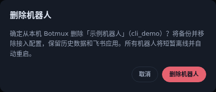

# 从 Dashboard 删除机器人

以管理员身份打开 Dashboard，在「Bot 配置」页选中机器人，再点击顶部的「删除机器人」。确认框会显示名称和 App ID，防止误删同名机器人。

确认后，Botmux 会先备份 `bots.json`，停止进程组，再原子移除选中机器人的接入配置并自动重启。所有机器人会短暂离线；重新连接后，页面确认机器人已经从列表移除才提示成功。备份位于配置文件旁，文件名为 `bots.json.before-delete-<随机标识>.bak`，仅当前系统用户可读写。

历史会话数据和飞书应用会保留。如需重新接入，可以通过「添加机器人」恢复配置。如果其它机器人把目标配置为额度交接对象，需要先修改对应交接配置。移除被可恢复会话引用的 Codex 实例池时，也会沿用原有配置保护并拒绝删除。

删除接口仅限宿主管理员且要求同源请求。后台重启流程会在进程组锁和配置锁内重新验证目标，避免使用过期的列表位置删除其它机器人。
